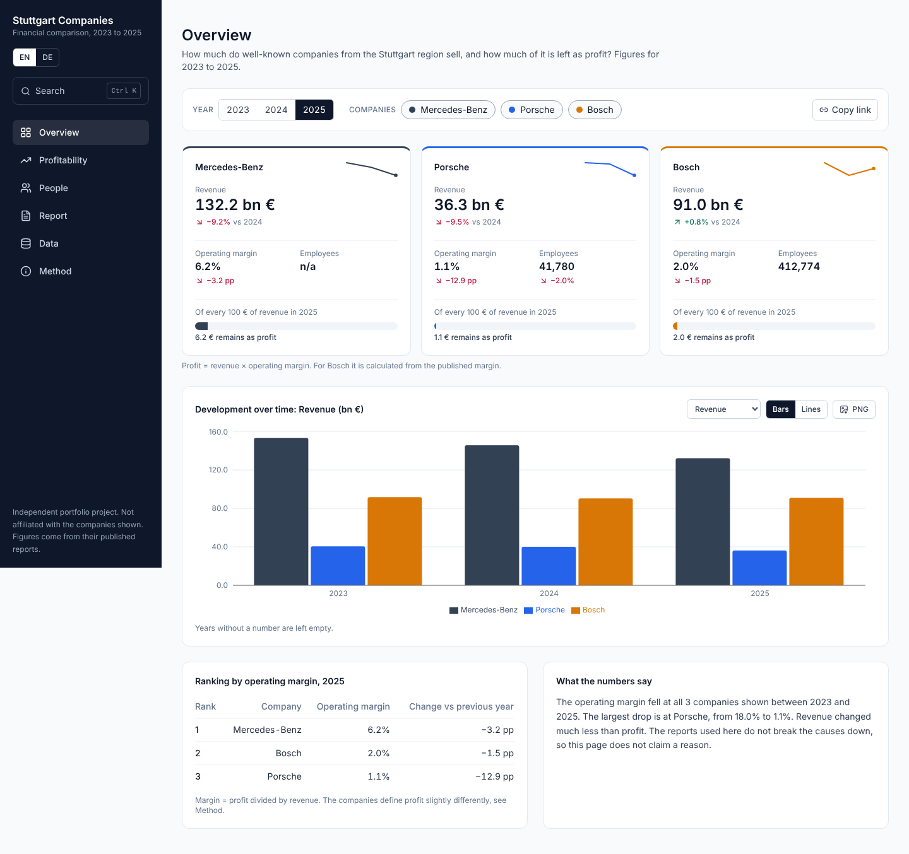
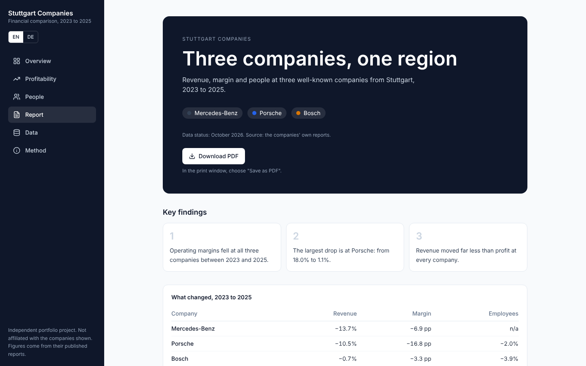

# Unternehmen aus Stuttgart: Finanzvergleich

[English](README.md)

Ein kleines Dashboard, das drei bekannte Unternehmen aus der Region Stuttgart (Mercedes-Benz Group, Porsche AG, Bosch Gruppe) für 2023 bis 2025 vergleicht: Umsatz, operative Marge und Mitarbeitende. Alle Zahlen stammen aus den veröffentlichten Berichten der Unternehmen.

> Unabhängiges Portfolio-Projekt. Keine Verbindung zu den gezeigten Unternehmen. Es werden keine Logos oder Markenmaterialien verwendet.

## Funktionen

- **Filter:** Jahr und Unternehmen wählen. Die Auswahl steht in der Adresse (`?y=2024&c=bosch`), ein Link öffnet also dieselbe Ansicht.
- **Befehlspalette:** Strg/⌘ + K öffnet Seiten, Sprach- und Jahreswechsel, Ein-/Ausblenden von Unternehmen, Link kopieren und CSV-Download.
- **Diagramme:** Kennzahl wählbar, Balken oder Linien, Umsatzindex (erstes Jahr = 100), Margen-Heatmap, Streudiagramm Umsatz/Marge und PNG-Download für jedes Diagramm.
- **Was-wäre-wenn-Rechner:** Gewinn bei anderer Marge, reine Rechnung (keine Prognose).
- **Mitarbeitenden-Ansicht:** Mitarbeitende, Umsatz und Gewinn je Person und welche Zahlen die Quellen liefern.
- **Bericht:** ein langer, scrollbarer Bericht mit einem Kapitel je Unternehmen (Profil, Kennzahlen, Tabelle Jahr für Jahr, Diagramm). Der Button "PDF herunterladen" öffnet den Druckdialog des Browsers; dort "Als PDF speichern" wählen. Beispieldateien: `docs/sample-report-en.pdf` und `docs/sample-report-de.pdf`.
- **Import:** eigene CSV-Datei laden (gleiche Spalten wie `data/companies_raw.csv`). Sie wird geprüft, falsche Zeilen werden verständlich gemeldet, und alle Seiten sowie der Bericht rechnen neu. Die Datei bleibt im Browser und wird nirgendwohin hochgeladen.
- **Export:** den aktuellen Datensatz als CSV oder JSON herunterladen, außerdem eine CSV-Vorlage.
- **Datenansicht:** durchsuchbare und sortierbare Tabelle aller Zeilen mit Quellen.
- **Englisch und Deutsch**, Desktop und Smartphone.

## Fragestellung

Wie viel verkaufen diese Unternehmen, und wie viel davon bleibt als Gewinn? Der Umsatz hat sich zwischen 2023 und 2025 wenig verändert, die operative Marge ist bei allen drei Unternehmen gesunken.

## Daten

- Datei: `data/companies_raw.csv` (10 Zeilen: Unternehmen, Jahr, Umsatz, Gewinnkennzahl, Gewinn, Mitarbeitende, Quellenhinweis)
- Quellen: offizielle Investor-, Presse- und Geschäftsberichtsseiten, aufgelistet auf der Seite "Methode" und in `docs/data-sources.md`
- Fehlende Werte bleiben leer und werden nicht geschätzt
- Die Zahlen von Mercedes-Benz stammen aus Pressemitteilungen und sind dort als vorläufig und ungeprüft gekennzeichnet

## Vorgehen

1. Umsatz, Gewinn und Mitarbeitendenzahlen von Hand von den offiziellen Seiten erfassen.
2. Nur 2023 bis 2025 verwenden, also die Jahre, die für alle drei Unternehmen vergleichbar vorliegen.
3. Operative Marge = Gewinn / Umsatz. Bosch veröffentlicht die Marge direkt.
4. Umsatz je Mitarbeitendem = Umsatz / Mitarbeitende, nur wenn beide Werte vorliegen.

Die Gewinnkennzahlen unterscheiden sich (bereinigtes EBIT, operatives Ergebnis, EBIT-Marge aus dem operativen Geschäft). Der Vergleich zeigt daher die Richtung, nicht wer besser ist.

## Seiten

Überblick, Rentabilität, Mitarbeitende, Bericht, Daten und Methode. Jede Seite gibt es auf Englisch (`/en`) und Deutsch (`/de`) mit Sprachumschalter. Die Startseite `/` öffnet die Sprache des Browsers.

## Technik

Next.js 16 (App Router), React 19, Tailwind CSS 3, Recharts, lucide-react. Die Daten werden beim Build aus der CSV gelesen. Alle Texte stehen in `lib/i18n.js`.





## Lokal starten

```bash
npm install
npm run dev
```

Danach http://localhost:3000 öffnen.

## Veröffentlichen

Das Repository auf vercel.com importieren (Add New, Project) und auf Deploy klicken. Umgebungsvariablen sind nicht nötig.

## Was ich gelernt habe

Unternehmen berichten Gewinn unterschiedlich, deshalb beginnt ein fairer Vergleich mit einer gemeinsamen Kennzahl. Die Grenzen der Daten zu dokumentieren gehört zur Analyse.
