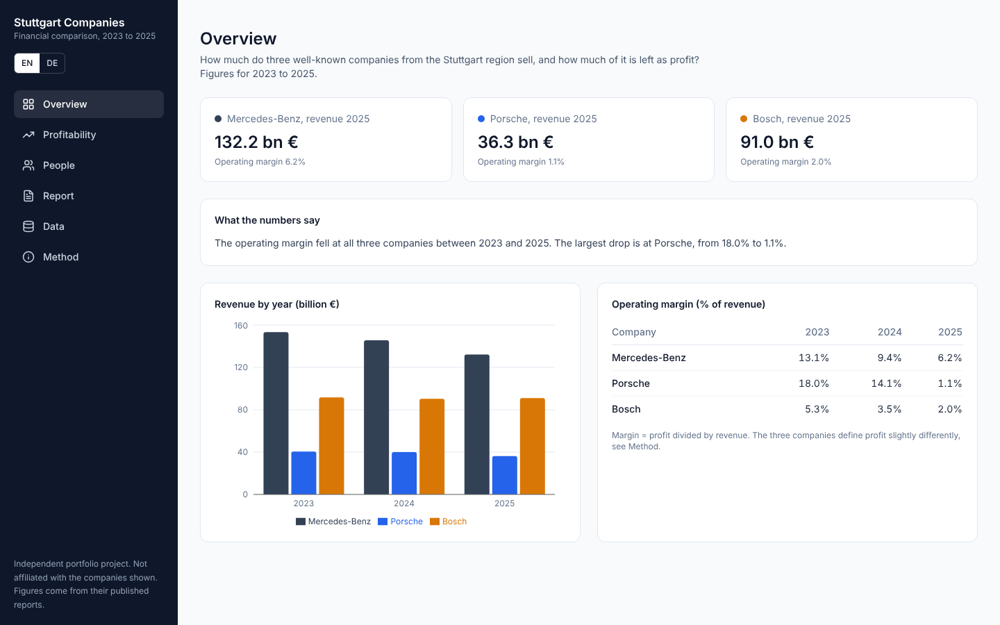

# Stuttgart Companies: Finanzvergleich

[English](README.md)

Ein kleines Dashboard, das Mercedes-Benz Group, Porsche AG und Bosch Group für 2023 bis 2025 vergleicht: Umsatz, operative Marge und Beschäftigte. Alle Zahlen stammen aus den veröffentlichten Berichten der Unternehmen.

> Unabhängiges Portfolio-Projekt. Keine Verbindung zu den Unternehmen. Keine Logos oder Markenmaterialien.



## Fragestellung

Wie viel verkaufen diese Unternehmen, und wie viel davon bleibt als Gewinn? Der Umsatz hat sich zwischen 2023 und 2025 kaum verändert, die operative Marge ist bei allen drei gesunken.

## Funktionen

- Seiten Überblick, Rentabilität, Mitarbeitende, Bericht, Daten und Methode, auf Englisch (`/en`) und Deutsch (`/de`), für Desktop und Handy
- Filter für Jahr und Unternehmen, im Link gespeichert, sodass ein Link dieselbe Ansicht öffnet
- Diagramme mit Kennzahlenauswahl, Umsatzindex, Margen-Heatmap und Streudiagramm, jeweils mit PNG-Download
- Was-wäre-wenn-Rechner: Gewinn bei einer anderen Marge (einfache Rechnung, keine Prognose)
- Berichtsseite mit einem Kapitel pro Unternehmen; „PDF herunterladen“ nutzt den Druckdialog des Browsers (Beispiele in `docs/`)
- Eigene CSV-Datei importieren (gleiche Spalten wie `data/companies_raw.csv`), Zeile für Zeile geprüft. Sie bleibt im Browser.
- Export als CSV oder JSON, Befehlspalette mit Strg/⌘ + K

## Daten und Methode

- `data/companies_raw.csv`: 10 Zeilen mit Umsatz, Gewinnkennzahl, Gewinn, Beschäftigten und einer Quellenangabe pro Zeile
- Quellen sind offizielle Investoren-, Presse- und Geschäftsberichtsseiten, aufgelistet in `docs/data-sources.md` und auf der Methodenseite
- Fehlende Werte bleiben leer und werden nie geschätzt
- Operative Marge = Gewinn / Umsatz (Bosch veröffentlicht die Marge direkt). Umsatz pro Beschäftigtem nur, wenn beide Werte vorliegen.
- Die Gewinnkennzahlen unterscheiden sich (bereinigtes EBIT, Operatives Ergebnis, EBIT-Marge), der Vergleich zeigt daher die Richtung, nicht wer besser ist.
- Die Zahlen von Mercedes-Benz stammen aus Pressemitteilungen und sind vorläufig und ungeprüft.

## Lokal starten

```bash
npm install
npm run dev
```

Öffne http://localhost:3000. Zum Veröffentlichen das Repository auf Vercel importieren; Umgebungsvariablen sind nicht nötig.

Gebaut mit Next.js 16, React 19, Tailwind CSS 3 und Recharts. Die CSV wird beim Build gelesen. Die Texte stehen in `lib/i18n*.js`.

## Was ich gelernt habe

Unternehmen weisen Gewinne unterschiedlich aus, ein fairer Vergleich beginnt deshalb mit einer gemeinsamen Kennzahl. Die Grenzen der Daten zu benennen gehört zur Analyse.

## Wie es entstanden ist

Dieses Projekt habe ich gemeinsam mit Claude (Anthropic) als KI-Assistent gebaut. Ich habe die Fragestellung und die Unternehmen gewählt, die Zahlen gesammelt und mit den Quellen abgeglichen, den Umgang mit Lücken festgelegt und das Ergebnis getestet. Claude hat die ersten Code-Entwürfe größtenteils geschrieben und seine Entscheidungen erklärt. Ich erkläre gern die Daten und den Code.
