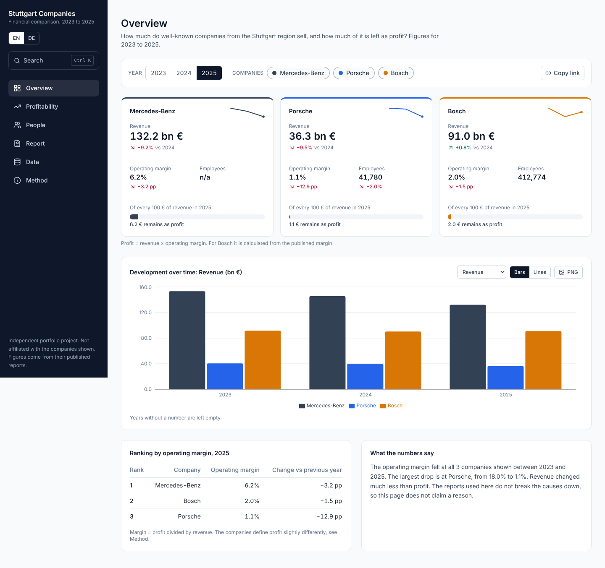

# Stuttgart Companies: Financial Comparison

[Deutsch](README.de.md)

A small dashboard that compares Mercedes-Benz Group, Porsche AG and Bosch Group for 2023 to 2025: revenue, operating margin and employees. All figures come from the companies' own published reports.

> Independent portfolio project. Not affiliated with the companies. No logos or brand material.



## Question

How much do these companies sell, and how much of it stays as profit? Revenue changed little between 2023 and 2025, while the operating margin fell at all three.

## What it does

- Overview, Profitability, People, Report, Data and Method pages, in English (`/en`) and German (`/de`), on desktop and phone
- Filters for year and companies, kept in the URL so a link opens the same view
- Charts with a metric picker, revenue index, margin heatmap and scatter plot, each with PNG download
- What-if calculator: profit at a different margin (plain arithmetic, not a forecast)
- Report page with a chapter per company; "Download PDF" uses the browser print dialog (samples in `docs/`)
- Import your own CSV (same columns as `data/companies_raw.csv`), checked line by line. It stays in the browser.
- Export as CSV or JSON, command palette with Ctrl/⌘ + K

## Data and method

- `data/companies_raw.csv`: 10 rows with revenue, profit measure, profit, employees and a source note per row
- Sources are official investor, press and annual report pages, listed in `docs/data-sources.md` and on the Method page
- Missing values stay empty and are never estimated
- Operating margin = profit / revenue (Bosch publishes the margin directly). Revenue per employee only where both values exist.
- The profit measures differ (adjusted EBIT, operating result, EBIT margin), so the comparison shows direction, not who is better.
- Mercedes-Benz figures come from press releases and are preliminary and unaudited.

## Run locally

```bash
npm install
npm run dev
```

Open http://localhost:3000. To deploy, import the repository on Vercel; no environment variables are needed.

Built with Next.js 16, React 19, Tailwind CSS 3 and Recharts. The CSV is read at build time. Texts are in `lib/i18n*.js`.

## What I learned

Companies report profit in different ways, so a fair comparison starts with a common measure. Writing down the limits of the data is part of the analysis.

## How it was built

I built this project together with Claude (Anthropic), used as an AI assistant. I chose the question and the companies, collected and checked the figures against the sources, decided how to handle gaps, and tested the result. Claude wrote most of the first code drafts and explained its choices. I can walk through the data and the code.
